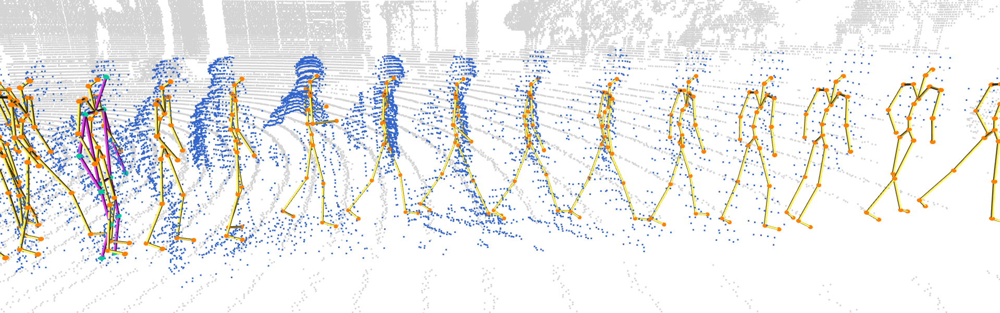

<div align="center">
<h1>Waymo-3DSkelMo: A Multi-Agent 3D Skeletal Motion Dataset for Pedestrian Interaction Modeling in Autonomous Driving </h1>

<h3 align="center">ACM MM 2025</h3>

<a href="https://arxiv.org/abs/2508.09404"></a>
<a href="https://guangxunzhu.github.io/Waymo3DSkelMo-Project/"></a>


[Guangxun Zhu](https://guangxunzhu.github.io)<sup>1</sup>, [Shiyu Fan](https://www.gla.ac.uk/pgrs/shiyufan/)<sup>1</sup>, [Hang Dai](https://dai-hang.github.io)<sup>1,2</sup>, [Edmond S. L. Ho](http://www.edho.net)<sup>1*</sup>

<sup>1</sup> [University of Glasgow](https://www.gla.ac.uk/), <sup>2</sup> Wuhan University

<p align="center">
  
</p>

</div>


## Overview

**Waymo-3DSkelMo** is a large-scale dataset of high-quality, temporally coherent multi-person 3D skeletal motions with explicit interaction semantics, derived from the [Waymo Perception dataset](https://waymo.com/open/data/perception/) and designed for fine-grained pedestrian interaction understanding in autonomous driving scenarios.

Due to the [Waymo Open Dataset Terms of Use](https://waymo.com/open/terms/), we are currently **not allowed to directly redistribute the processed data**. Instead, this repository provides:
- The complete code to generate **Waymo-3DSkelMo** from the official [Waymo Open Dataset](https://waymo.com/open/).
- Step-by-step instructions to reproduce our dataset on your own machine.

We are actively communicating with the Waymo team to seek permission to release **Waymo-3DSkelMo** directly. Once we receive approval, we will update this repository and provide direct download links.

> Note: This is the **second version** of **Waymo-3DSkelMo**.  
> Compared with the version in our paper, we have improved the overall data quality; for more details, please refer to our [project page](https://guangxunzhu.github.io/Waymo3DSkelMo-Project/).

Please note that by using our code and the generated dataset, you must also comply with the [Waymo Open Dataset Terms of Use](https://waymo.com/open/terms/).

## News
- [2025/12]: We release **Waymo-3DSkelMo** for academic usage.

## Getting started

This code was developed and tested on **Ubuntu 22.04 LTS**.

### Environment Setup

We rely on several external projects and their corresponding environments. Our environment configurations are slightly adapted from the originals; you may either use the setups we provide here or follow the environment settings in the original repositories:

- **waymo_tf:** Python 3.10, CUDA 11.8, tensorflow 2.12.0 – see [Waymo tutorial_v2](https://github.com/waymo-research/waymo-open-dataset/blob/master/tutorial/tutorial_v2.ipynb)
- **lidar-hmr:** Python 3.8, CUDA 11.3, PyTorch 1.10.1 – see [LiDAR-HMR](https://github.com/soullessrobot/LiDAR-HMR)
- **rohm:** Python 3.8, CUDA 11.3, PyTorch 1.10.0 – see [HuMoR](https://github.com/davrempe/humor/tree/main)
- **NeMF:** Python 3.9, CUDA 12.8, PyTorch 2.8 – see [NeMF](https://github.com/c-he/NeMF/tree/main)

If you encounter environment-related issues, please refer to the corresponding repository linked above.

We provide YAML files for each environment under the `envs/` directory. You can create all environments with:

```bash
conda env create -f envs/waymo_tf.yml
conda env create -f envs/lidar-hmr.yml
conda env create -f envs/rohm.yml
conda env create -f envs/NeMF.yml
```
### Downloads

Before running the pipeline, please download the raw Waymo Perception data and the dependency files from the external projects, including pretrained weights, body models, and other required assets.

#### Raw Waymo Perception data

Please create a root data directory `<dataset_root>` and ensure at least **270 GB** of free space to store the raw Waymo Perception data, the final processed Waymo-3DSkelMo dataset, and intermediate files generated during preprocessing.


To obtain the raw Waymo Perception data, first apply for access to the [Waymo Open Dataset](https://waymo.com/open/download/?_gl=1*10p095u*_up*MQ..*_ga*NzkzNjg3Mjc4LjE3NjU0NzgzMjE.*_ga_KDWQB0N19R*czE3NjU0NzgzMjEkbzEkZzAkdDE3NjU0NzgzMjEkajYwJGwwJGgw) on the official website and agree to the Waymo Open Dataset Terms of Use, then request and download the **Perception Dataset v2.0.1** subset.

For our code, you only need the `lidar`, `lidar_box`, `lidar_hkp`, `lidar_calibration`, `lidar_pose`, and `vehicle_pose` parquet components for the **training** and **validation** splits, organized as:

```text
<dataset_root>/
  waymo/
    training/
      lidar/
      lidar_box/
      lidar_hkp/
      lidar_calibration/
      lidar_pose/
      vehicle_pose/
    validation/
      lidar/
      lidar_box/
      lidar_hkp/
      lidar_calibration/
      lidar_pose/
      vehicle_pose/
```

#### LiDAR-HMR

1. **Pretrained model**: Download the LiDAR-HMR pretrained models from [this link](https://cloud.tsinghua.edu.cn/d/937a4af3a7cb4c5b8e89/). Keep only `lidar_hmr_ckpt/waymov2` and place it under: `LiDAR-HMR/lidar_hmr_ckpt/waymov2/`
2. **Body models**: Download the SMPL-X model weights from the official [SMPL-X website](https://smpl-x.is.tue.mpg.de/) into: `LiDAR-HMR/smplx_models/`. Then download the [SMPL](https://smpl.is.tue.mpg.de/) model, rename the neutral model file to `SMPL_NEUTRAL.pkl`, and place it under: `LiDAR-HMR/smplx_models/smpl/SMPL_NEUTRAL.pkl`
3. **Other dependencies**: [Point Transformer-V2](https://github.com/Pointcept/PointTransformerV2) and [ChamferDistancePytorch](https://github.com/ThibaultGROUEIX/ChamferDistancePytorch) are included in the `LiDAR-HMR` folder; please install and compile them following their official documentation.

#### HuMoR
Please download SMPL+H and (optionally) VPoser following the instructions in the official [HuMoR repository](https://github.com/davrempe/humor), and place them under: `/humor/body_models/`

#### NeMF
1. **Body model and AMASS dataset**: [NeMF](https://github.com/c-he/NeMF) repository used to provide preprocessed body models and AMASS data, but these links are no longer available due to license restrictions. You may need to obtain and preprocess the body models and AMASS dataset yourself; please refer to the discussion in [NeMF issue #1](https://github.com/c-he/NeMF/issues/1) for more information.
2. **Pretrained model**: Download the pretrained generative NeMF model and the global motion predictor from the links provided in the [official NeMF repository](https://github.com/c-he/NeMF), and extract them to: `NeMF/outputs/`

### Dataset Generation


Update the `root_dir` in `configs/pipeline.yaml` to the `<dataset_root>` you set above. Then you can launch the full pipeline with:

```bash
python scripts/run_pipeline.py
```

This script will run all stages of the dataset generation pipeline. If preferred, you can also execute the individual stage scripts step by step instead of using the unified entry point.

> Note: The extract_waymo stage (parsing the raw Waymo Perception data) is very time-consuming.


### Evaluation

To evaluate the generated dataset, run:

```bash
python evaluation/metrics.py --generated-root <dataset_root>/generated/final_10fps --waymo-root <dataset_root>/waymo_extracted
```

This script above computes the following metrics: MPJPE, Jitter, KP-Box (the ratio of keypoints that fall inside their corresponding bounding boxes.)


If you want to evaluate FID, you first need to process the HumanML3D dataset using the [HumanML3D](https://github.com/EricGuo5513/HumanML3D) codebase. After preparing HumanML3D, process our generated dataset by running the following notebooks in `evaluation` folder in order:

1. `raw_pose_processing_waymo.ipynb`
2. `motion_representation_waymo.ipynb`
3. `cal_mean_variance_waymo.ipynb`

We follow the FID computation protocol from the [diffusion-motion-inbetweening](https://github.com/setarehc/diffusion-motion-inbetweening) project.

Please first download the SMPL and T2M evaluators following the instructions in the official [diffusion-motion-inbetweening](https://github.com/ChenFengYe/motion-inbetweening-diffusion) repository.  
The SMPL files should be stored in: `evaluation/body_models/smpl/`.

The original T2M evaluator link in diffusion-motion-inbetweening is no longer valid.  
Instead, please refer to [MDM issues](https://github.com/GuyTevet/motion-diffusion-model/issues/222).

Download and unzip the archive, then from the extracted folders locate the innermost `t2m` directory and move it to the project root: `<project_root>/t2m`.

# Acknowledgements

We gratefully acknowledge that our work is primarily built upon the [Waymo Open Dataset](https://waymo.com/open), [LiDAR-HMR](https://github.com/soullessrobot/LiDAR-HMR), and [NeMF](https://github.com/c-he/NeMF). We also make use of several libraries and toolkits, including [SMPL](https://smpl.is.tue.mpg.de/), [SMPL+H](https://mano.is.tue.mpg.de/), [SMPL-X](https://smpl-x.is.tue.mpg.de/), [HuMoR](https://github.com/davrempe/humor), [Point Transformer-V2](https://github.com/Pointcept/PointTransformerV2), [ChamferDistancePytorch](https://github.com/ThibaultGROUEIX/ChamferDistancePytorch), [HumanML3D](https://github.com/EricGuo5513/HumanML3D), and [diffusion-motion-inbetweening (T2M evaluators)](https://github.com/setarehc/diffusion-motion-inbetweening). We thank all of these works for making their code, models, and datasets publicly available.


# Bibtex
If this work is helpful for your research, please cite the following BibTeX entry.

```
@inproceedings{zhu2025waymo,
  title={Waymo-3DSkelMo: A Multi-Agent 3D Skeletal Motion Dataset for Pedestrian Interaction Modeling in Autonomous Driving},
  author={Zhu, Guangxun and Fan, Shiyu and Dai, Hang and Ho, Edmond SL},
  booktitle={Proceedings of the 33rd ACM International Conference on Multimedia},
  pages={13184--13190},
  year={2025}
}
```

